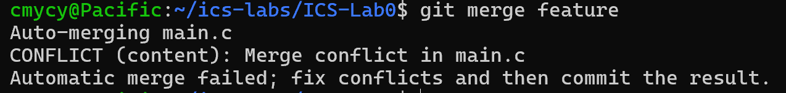
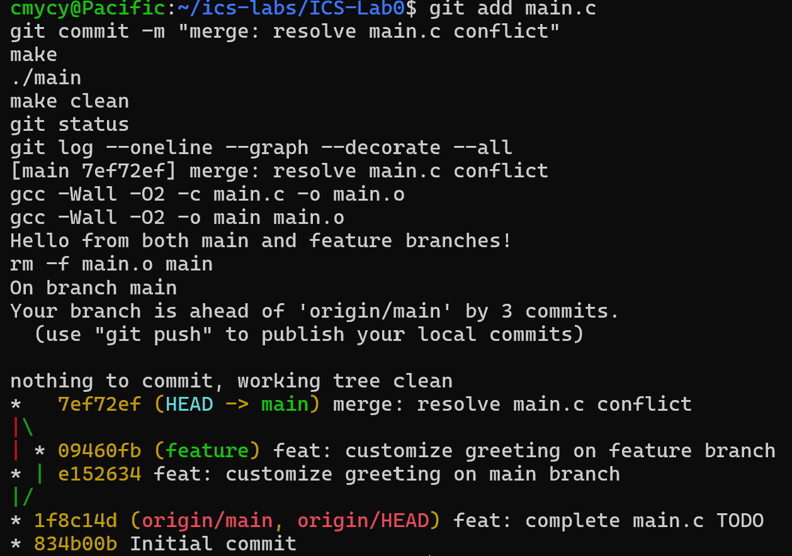

# 计算机系统基础 Lab0：GitLab 实验报告

## 1. 基本信息

- 姓名：蔡明洋
- 学号：24300240156
- GitHub 用户名：`qinshou-hub`
- 实验环境：Windows、WSL2 Ubuntu、Visual Studio Code
- 工具版本：GCC 15.2.0、GNU Make 4.4.1、Git 2.53.0

## 2. 实验目的

本实验的目的是熟悉 Git 和 GitHub 的基本使用方法，理解工作区、暂存区和版本库之间的关系，掌握提交、分支、合并及冲突解决等操作，并学习使用规范的提交信息记录开发过程。

## 3. 文档问题

### 3.1 多人协同开发经历

在本实验之前，我没有完整使用 Git 进行多人协同开发的经历，对分支、暂存、提交和合并等协作流程也不熟悉。通过本实验，我理解了多人开发时可以为不同功能建立独立分支，开发者在各自分支中完成修改和提交，再通过合并或 Pull Request 将成果整合到主分支。这样既能减少开发过程中的相互干扰，也能保留清晰的修改记录，便于审查、定位问题和回退。

### 3.2 Git 为什么设计“暂存—提交”两个步骤

工作区中可能同时存在多项修改，但这些修改未必属于同一个任务。如果修改后直接提交，很容易把尚未完成或与当前任务无关的内容一起写入历史。暂存区提供了一个提交前的选择和检查阶段：开发者可以使用 `git add` 精确选择本次提交包含的文件或改动，再通过 `git diff --cached` 检查即将提交的内容，最后执行 `git commit`。这种设计有助于形成内容单一、容易理解和回退的原子提交，也降低了误提交文件的风险。

### 3.3 `git branch` 和 `git branch -a` 的区别

- `git branch` 默认只显示本地分支，并用 `*` 标出当前所在分支。
- `git branch -a` 会同时显示本地分支和远程跟踪分支，例如 `remotes/origin/main` 和 `remotes/origin/feature`。

远程跟踪分支是本地保存的远程仓库分支状态，并不等同于可以直接编辑的本地分支。

## 4. 阅读材料总结

### 4.1 Commit Message 规范

Commit Message 应简洁、明确地说明一次提交完成了什么。规范化的提交信息通常包含类型、可选的影响范围和简短说明，例如：

```text
feat: complete main.c TODO
docs: add lab report
```

其中 `feat` 表示新增或修改功能，`fix` 表示修复问题，`docs` 表示文档修改。规范的提交信息可以让其他开发者快速了解变更目的，也便于生成更新日志、检索历史和定位引入问题的提交。本实验中，我使用了 `feat:` 和 `merge:` 等前缀描述不同类型的操作，使提交历史更加清楚。

### 4.2 语义化版本

语义化版本通常采用 `主版本号.次版本号.修订号`，即 `MAJOR.MINOR.PATCH` 的形式：

- 进行了不兼容的接口修改时增加主版本号；
- 以向后兼容的方式增加功能时增加次版本号；
- 进行了向后兼容的问题修复时增加修订号。

语义化版本还可以使用预发布标识和构建元数据。它通过统一的版本含义帮助使用者判断升级风险，也方便依赖管理工具选择兼容版本。

### 4.3 为什么要学习 Git

Git 不仅用于备份代码，更重要的是记录项目的演变过程。它可以比较不同版本、恢复误修改、并行开发不同功能，并明确每次修改的作者和目的。在多人协作中，分支和合并机制能让成员独立工作后再整合成果；在个人项目中，清晰的提交历史同样有助于复盘和排错。Git 还与 GitHub Actions 等自动化工具相结合，是代码审查、持续集成和软件发布流程的基础，因此学习 Git 是进行现代软件开发的重要准备。

## 5. 实验过程

### 5.1 配置 WSL2 开发环境

我在 Windows 中打开 Ubuntu 终端。启动时 WSL 提示检测到 Windows 的 `localhost` 代理，但没有镜像到 NAT 模式的 WSL。随后执行 `sudo apt update` 能正常从 Ubuntu 软件源获取数据，说明该提示没有影响本次实验的网络连接。

安装编译工具并检查版本：

```bash
sudo apt update
sudo apt install -y build-essential
gcc --version
make --version
git --version
```

最终确认 GCC、Make 和 Git 均可正常使用。

### 5.2 配置 Git 和 SSH

配置 Git 用户信息和默认分支：

```bash
git config --global user.name "qinshou-hub"
git config --global user.email "GitHub 账户中已验证的邮箱"
git config --global init.defaultBranch main
```

在 WSL 中生成 ED25519 SSH 密钥，将公钥添加到 GitHub 的 `SSH and GPG keys` 页面，并进行测试：

```bash
ssh-keygen -t ed25519 -C "GitHub 账户中已验证的邮箱"
cat ~/.ssh/id_ed25519.pub
ssh -T git@github.com
```

终端返回 `You've successfully authenticated`，说明 WSL 已能通过 SSH 访问 GitHub。

### 5.3 使用模板仓库并完成 TODO

我通过课程模板仓库的 **Use this template** 功能创建了个人仓库 `qinshou-hub/ICS-Lab0`，没有使用 Fork，也没有修改 `.github/workflows`。随后将个人仓库克隆到 WSL 的 `~/ics-labs/ICS-Lab0` 目录。

原始 `main.c` 输出 `Hello, world!`。我完成 TODO，将其修改为：

```c
printf("I am learning Git in FDU ICS Lab0!\n");
```

编译和运行程序：

```bash
make
./main
make clean
```

程序正确输出预期文字。随后检查修改、暂存并提交：

```bash
git status
git diff
git add main.c
git diff --cached
git commit -m "feat: complete main.c TODO"
git push origin main
```

该步骤产生提交 `1f8c14d`。

### 5.4 创建分支并制造合并冲突

首先创建并切换到 `feature` 分支：

```bash
git switch -c feature
```

在 `feature` 分支中把同一行修改为：

```c
printf("Hello from the feature branch!\n");
```

提交为 `09460fb feat: customize greeting on feature branch`。

然后切换回 `main`，把相同位置修改为：

```c
printf("Hello from the main branch!\n");
```

提交为 `e152634 feat: customize greeting on main branch`。由于两个分支从同一个基础版本出发，又分别修改了 `main.c` 的同一行，执行下面的命令时 Git 无法自动判断应该保留哪一项修改，因此发生内容冲突：

```bash
git merge feature
```

<!-- 请将发生冲突时包含 CONFLICT 提示或冲突标记的截图保存为 images/merge-conflict.png -->



冲突文件中出现了 `<<<<<<< HEAD`、`=======` 和 `>>>>>>> feature` 标记。我阅读两侧内容后删除冲突标记，并将最终结果整理为：

```c
printf("Hello from both main and feature branches!\n");
```

然后完成合并提交并重新测试：

```bash
git add main.c
git commit -m "merge: resolve main.c conflict"
make
./main
make clean
git status
git log --oneline --graph --decorate --all
```

最终合并提交为 `7ef72ef`，程序输出为：

```text
Hello from both main and feature branches!
```

<!-- 请将解决冲突后的提交图截图保存为 images/merge-resolved.png -->



### 5.5 推送分支并排查问题

`main` 分支成功推送后，我继续推送 `feature` 分支。第一次执行 `git push -u origin feature` 时终端长时间没有输出，因此使用 `Ctrl+C` 中止，并依次检查远程分支和 SSH 认证：

```bash
git branch -r
ssh -T git@github.com
```

SSH 认证正常，但当时远程尚不存在 `feature`。为观察具体进度，我使用：

```bash
git push --verbose --progress origin feature:feature
```

GitHub 返回 `[new branch] feature -> feature`，说明远程分支成功创建。输出中的 `Total 0` 也是正常的，因为 `feature` 提交所对应的对象已经通过合并后的 `main` 上传，这次只需要在远程新建分支引用。最后检查确认 `origin/main` 和 `origin/feature` 均存在。

## 6. 实验结果

最终提交图如下：

```text
*   7ef72ef (main, origin/main) merge: resolve main.c conflict
|\
| * 09460fb (feature, origin/feature) feat: customize greeting on feature branch
* | e152634 feat: customize greeting on main branch
|/
* 1f8c14d feat: complete main.c TODO
* 834b00b Initial commit
```

实验完成了以下目标：

1. 在 WSL2 中配置了 C 语言编译环境和 Git。
2. 使用课程模板创建个人仓库并通过 SSH 与 GitHub 通信。
3. 修改、编译和运行了 `main.c`，并完成独立提交。
4. 在 `main` 和 `feature` 分支中分别进行了修改和提交。
5. 主动制造、理解并解决了同一行代码产生的合并冲突。
6. 将两个分支及完整提交历史推送到了 GitHub。

## 7. 实验总结

本次实验让我第一次完整经历了从配置环境、创建仓库、修改代码到分支合并和远程推送的 Git 工作流程。实际操作中，我认识到终端输出是判断操作状态的重要依据。例如，`working tree clean` 表示当前修改已经处理完毕，`main -> main` 和 `[new branch] feature -> feature` 表示远程推送成功，而 `You've successfully authenticated` 表示 SSH 配置正确。

我也遇到了两类容易误判的问题。第一类是 WSL 启动时的代理警告，但通过 `apt update` 可以确认网络实际上正常；第二类是推送分支时长时间没有输出。通过中止操作、检查远程分支、单独测试 SSH、再使用带详细进度的推送命令，最终确定代码没有丢失并顺利完成推送。这让我理解了排错时应当先保护现有提交，再把认证、网络、远程分支等环节逐一检查，而不是反复执行不确定的操作。

合并冲突也不代表程序或仓库损坏，而是 Git 无法自动决定如何整合两项修改。只要阅读冲突标记、选择合理的最终内容、重新暂存并提交，就可以安全地完成合并。相比只记忆命令，本实验让我更清楚每条命令改变的是工作区、暂存区、本地仓库还是远程仓库。

## 8. 建议

建议实验文档在 SSH 和推送部分补充常见成功提示与故障表现，例如 SSH 测试中的 `does not provide shell access` 实际表示认证成功，以及推送卡住时可以先检查远程分支和 SSH 状态。对第一次接触 Git 的同学而言，这些说明有助于区分正常提示、警告和真正的错误。
